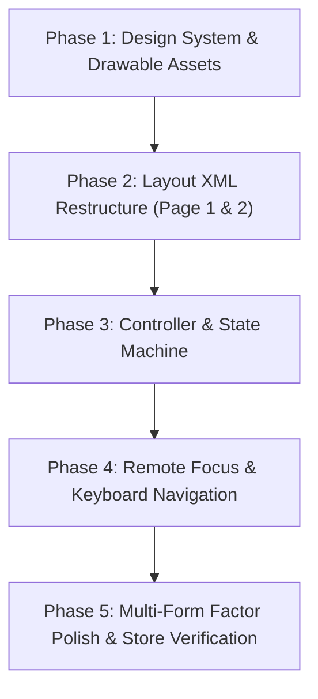

# HamClock Android Settings Screen Redesign Plan
**Adopting the Amazon Fire TV Vega Settings UI Formatting while Preserving Android Multi-Platform Features**

---

## 1. Executive Summary & Objective

The recent port of HamClock to Amazon Fire TV Vega (`vega/`) introduced a modern, polished settings experience:
- A sleek, dark slate and amber overlay panel docked over the clock.
- A streamlined **two-page architecture** separating quick operational controls (status, LAN toggle, QR code sharing, setup, exit) from detailed configuration (network name, backend server, overscan, updates).
- Clear, high-contrast typography and focus states tailored for a 10-foot television experience.

While Vega simplified its settings by dropping unsupported OS features (such as boot receivers, background execution, and multiple app stores), the **Android app serves a wide range of form factors and distribution channels**:
1. **Form Factors:** Android TV, Google TV, Amazon Fire TV, Amazon Fire Tablets, and Android Phones/Tablets (touchscreens in portrait and landscape).
2. **Distribution Channels:** Google Play Store (with Play Core flexible background updates), Amazon Appstore, and direct GitHub APK releases.
3. **Android Platform Capabilities:** Start-on-boot configuration with OEM autostart helpers, continuous background execution for local HTTP/REST server serving, clipboard integration, and port conflict warnings.

### Objective
Redesign the Android settings screen to adopt Vega’s elegant two-page layout, visual design system, and focus ergonomics while keeping all Android platform features, multi-store support, and form-factor responsiveness completely intact.

---

## 2. Comparative Feature & Layout Matrix

| Feature / Setting | Vega Port (`vega/src/App.tsx`) | Current Android (`android/`) | Planned Android Redesign |
| :--- | :--- | :--- | :--- |
| **Presentation Style** | Overlay panel (`styles.panel`) over clock with dark translucent backdrop | Modal `AlertDialog` with vertical `ScrollView` | Custom overlay panel / sheet with dark backdrop and smooth transitions |
| **Layout Structure** | **Two Pages:**<br>• `PanelMain`: Quick status, buttons, LAN/QR card<br>• `PanelSettings`: Config fields | Single long vertical scrollable dialog | **Two Pages:**<br>• Page 1 (`PanelMain`): Quick status, buttons, LAN/QR card<br>• Page 2 (`PanelSettings`): Config fields |
| **Color Scheme** | Deep dark slate (`#0e1420`), amber accent (`#ffb547`), high-contrast text (`#e8eefc`) | Standard dark gray dialog (`Theme.AppCompat.Dialog.Alert`) | Matches Vega’s deep slate (`#0e1420`), amber accent (`#ffb547`), and danger tone (`#ff5d6c`) |
| **TV Focus Feedback** | Amber fill (`#ffb547`), dark text, scale zoom (1.04x), white focus rings | Basic drawable selector highlight | Scale zoom, high-contrast amber focus states, and explicit D-pad directional paths |
| **Engine Status & Ports** | Header subtext displaying engine state, version, and active ports | Plain text lines inside local access container | Prominent header card with engine status, version, and active ports |
| **Resume HamClock** | Default focused button on Page 1 | Not present (dismisses dialog via Cancel or Back) | Primary button on Page 1 (closes panel and returns focus to clock) |
| **LAN Access Toggle** | Instant toggle button with On/Off indicator and side card update | Checkbox with collapsible container below | Dedicated button on Page 1 with clear toggle status and immediate activation |
| **QR Code & URLs** | White rounded card with Live Clock vs Antennas tabs | Small image in dialog with tab buttons | Dedicated rounded card on Page 1 with Live vs Antennas tabs, URL badges, and Copy button |
| **Copy URL to Clipboard** | Omitted (Vega is TV-only, no clipboard UX) | `btn_copy_local_url` with toast | **Retained:** Appears on touch/tablet devices below URLs; clean D-pad accessible |
| **Network Name (mDNS)** | Field with `.local` suffix and dynamic status help text | Standard `EditText` | Formatted field with `.local` suffix badge and dynamic help text |
| **Backend Server** | SettingField with restart notice on exit | Standard `EditText` | Formatted field with restart warning and auto-clear cache on change |
| **Screen Safe Margin (Overscan)** | 3 segmented choices (None, 3%, 5%) | 3 buttons (None, 3%, 5%) | Styled segmented pill buttons (hidden on phones/tablets, visible on TV) |
| **Start on Boot** | Omitted (not supported on Vega) | CheckBox + OEM autostart helper banner | **Retained:** Moved to Page 2; hidden on unsupported TV OS, active on supported devices |
| **Run in Background** | Omitted (Vega terminates on exit) | CheckBox + explanatory subtext | **Retained:** Moved to Page 2 with clear descriptive toggle |
| **Update Check** | Simple toggle + Amazon Appstore alert | CheckBox + Play Core flexible update + store links | **Retained & Enhanced:** Toggle on Page 2; full multi-store backend intact |
| **HamClock Setup (-u)** | Button restarting straight to Setup | Button restarting straight to Setup | Styled action button on Page 1 |
| **Exit HamClock** | Danger-styled exit button | Button exiting app and killing processes | Styled danger button on Page 1 |
| **First-Run Setup Guidance** | Fullscreen Welcome guide with steps & QR code | Banner in dialog with auto-dismiss on callsign config | Unified guidance using Page 1 LAN/QR card with step-by-step instructions |

---

## 3. UX & UI Architecture

### Page 1: Quick Actions & LAN / QR Hub (`PanelMain`)
```
+---------------------------------------------------------------------------------------------------+
|  [Translucent Dark Backdrop: rgba(2, 4, 8, 0.6)]                                                  |
|                                                                                                   |
|  +--------------------------------------------+  +---------------------------------------------+  |
|  |  HAMCLOCK                                  |  |  [ LAN ACCESS & REMOTE CONNECTION CARD ]    |  |
|  |  Engine running  ·  v3.10                  |  |                                             |  |
|  |  Live :8081  ·  REST :8080  ·  LAN on      |  |  [ Live Clock ]     [ Antennas ]            |  |
|  |                                            |  |                                             |  |
|  |  [ Resume HamClock ]         (Default/OK)  |  |  Scan or open on a phone or computer:       |  |
|  |                                            |  |  +---------------------------------------+  |  |
|  |  [ LAN Access: On ]          (Toggle)      |  |  |                                       |  |  |
|  |                                            |  |  |             [ QR CODE ]               |  |  |
|  |  [ Settings… ]               (To Page 2)   |  |  |                                       |  |  |
|  |                                            |  |  +---------------------------------------+  |  |
|  |  [ Setup HamClock ]          (Reboot -u)   |  |                                             |  |
|  |                                            |  |  http://hamclock.local:8081/live.html       |  |
|  |  [ Exit HamClock ]           (Danger Tone) |  |  or http://192.168.1.150:8081/live.html     |  |
|  |                                            |  |                                             |  |
|  |                                            |  |  [ Copy URL ] (Touch devices)               |  |
|  +--------------------------------------------+  +---------------------------------------------+  |
+---------------------------------------------------------------------------------------------------+
```

### Page 2: Detailed Settings (`PanelSettings`)
```
+---------------------------------------------------------------------------------------------------+
|  SETTINGS                                                                                         |
|  Saved on this device. Press Back to return.                                                      |
|                                                                                                   |
|  Network Name                                                                                     |
|  [ hamclock                           ] .local                                                    |
|  Other devices can open http://hamclock.local:8081/live.html                                      |
|                                                                                                   |
|  Backend Server (host:port)                                                                       |
|  [ clearskyinstitute.com              ]                                                           |
|  Where HamClock gets its data. Leave empty for default. HamClock restarts when you leave.         |
|                                                                                                   |
|  Screen Safe Margin (Overscan)  *TV only*                                                         |
|  [ None ]   [ Normal (3%) ]   [ Large (5%) ]                                                      |
|  Shrinks the clock if your TV cuts off its edges.                                                 |
|                                                                                                   |
|  Start on Boot  *When supported on device*                                                        |
|  [x] Start HamClock automatically when device boots                                               |
|  [ OEM Autostart Guide button if needed ]                                                         |
|                                                                                                   |
|  Run in Background                                                                                |
|  [x] Keep HamClock web and REST services running when app is minimized                            |
|                                                                                                   |
|  Check for Updates                                                                                |
|  [ On ]   [ Off ]                                                                                 |
|  Notifies you when updates are available in Google Play or Amazon Appstore.                       |
|                                                                                                   |
|  [ < Back ]                     (Returns to Page 1)                                               |
+---------------------------------------------------------------------------------------------------+
```

---

## 4. Phased Implementation Plan (Reasonable Context Chunks)

Each phase is sized to be executed in **one complete conversation context**. When starting a new chat, you can refer to the phase number and its checklist.



---

### Phase 1: Design System, Colors & Drawable Assets [COMPLETED]
**Goal:** Establish the complete visual design language of Vega in Android resource files without altering application logic yet.

- [x] **Colors (`res/values/colors.xml`):**
  - Add settings overlay color palette (styled from Vega's slate/amber theme):
    - `settings_bg`: `#05070C`
    - `settings_backdrop`: `#99020408` (60% dark overlay)
    - `settings_panel`: `#F00E1420` (94% opacity `#0E1420`)
    - `settings_border`: `#2E78AAFF` (18% opacity `#78AAFF`)
    - `settings_text`: `#E8EEFC`
    - `settings_muted`: `#8EA0C2`
    - `settings_accent`: `#FFB547` (Amber Accent)
    - `settings_accent_bg`: `#14FFB547` (8% opacity Amber)
    - `settings_accent_border`: `#59FFB547` (35% opacity Amber)
    - `settings_accent_dim`: `#26FFB547` (15% opacity Amber)
    - `settings_danger`: `#FF5D6C` (Danger Red)
    - `settings_danger_dim`: `#26FF5D6C`
    - `settings_card_bg_off`: `#0AFFFFFF` (4% white)
    - `settings_btn_bg`: `#0FFFFFFF` (6% white)
    - `settings_btn_text_focused`: `#10131A`
- [x] **Color State Lists (`res/color/`):**
  - `settings_btn_text_selector.xml`: Focused dark text (`#10131A`), default light text (`#E8EEFC`).
  - `settings_btn_danger_text_selector.xml`: Focused white text, default danger red (`#FF5D6C`).
  - `settings_tab_text_selector.xml`: Focused dark text, selected amber (`#FFB547`), default muted (`#8EA0C2`).
- [x] **Drawable Selectors & Shapes (`res/drawable/`):**
  - `settings_panel_background.xml`: Rounded 16dp dark translucent container (`#0E1420`, 94%) with subtle border.
  - `settings_btn_default_selector.xml`: Rounded button (`10dp`) with amber fill and white stroke on focus.
  - `settings_btn_toggle_selector.xml`: Toggle button with amber outline and tinted background when active/selected.
  - `settings_btn_danger_selector.xml`: Danger button with `#FF5D6C` fill and white stroke on focus.
  - `settings_card_lan_active.xml`: Amber-tinted rounded card container (`14dp`).
  - `settings_card_lan_off.xml`: Subtle dark card container (`14dp`).
  - `settings_qr_frame.xml`: Clean white rounded frame for QR code (`14dp`).
  - `settings_input_background.xml`: Dark input with amber border focus glow (`8dp`).
  - `settings_chip_selector.xml`: Segmented choice chips (overscan, update check, tabs).
  - `settings_badge_suffix.xml`: Suffix badge (`.local`).
- [x] **Styles & Themes (`res/values/styles.xml`):**
  - `Theme.HamClock.SettingsDialog`: Borderless floating dialog with 0.60 dim amount.
  - Typography styles: `Settings.Text.Title` (22sp bold), `Settings.Text.Section` (14sp bold), `Settings.Text.Body`, `Settings.Text.Meta`, `Settings.Text.Url`.
  - Button & input styles: `Settings.Button`, `Settings.Button.Toggle`, `Settings.Button.Danger`, `Settings.Button.Tab`, `Settings.Button.Chip`, `Settings.EditText`.
- [x] **Verification:** Validated all XML resource files are well-formed and structured cleanly.

---

### Phase 2: Layout XML Structure (`PanelMain` & `PanelSettings`) [COMPLETED]
**Goal:** Build the two-page layout structure matching Vega's visual hierarchy while wiring all existing Android UI elements.

- [x] **Layout Modularization (`res/layout/`):**
  - Create `view_settings_panel_main.xml` and `res/layout-land/view_settings_panel_main.xml`:
    - Left column: Title, engine status chips, action buttons (`Resume`, `LAN Access Toggle`, `Settings…`, `Setup HamClock`, `Exit HamClock`).
    - Right column: `LanInfo` card with Live vs Antennas tab switcher, QR code frame with white rounded container, dynamic URL displays, and `btn_copy_local_url`.
    - First-run TV setup banner container (collapsible).
  - Create `view_settings_panel_settings.xml`:
    - Network name input with `.local` suffix badge and status guidance.
    - Backend host input with reset placeholder and restart warning.
    - Screen safe margin / Overscan selector (`[None]`, `[Normal 3%]`, `[Large 5%]`).
    - Android platform controls: Start on boot CheckBox, OEM autostart helper banner, Run in background CheckBox.
    - Auto-update toggle (`[On]`, `[Off]`).
    - Back button at bottom.
  - Create `dialog_settings_panel.xml`:
    - Root container with `ScrollView`, rounded settings panel card (`@drawable/settings_panel_background`), and `ViewFlipper` seamlessly hosting both `panel_main` and `panel_settings`.
- [x] **Responsive Design:**
  - On widescreen/TV: Side-by-side two-column presentation (left menu 340dp, right card 420dp in `res/layout-land/`).
  - On phones/portrait: Stacked card view with smooth scrolling and navigation to Page 2 in `res/layout/`.
- [x] **Verification:** Validated all XML layouts, element tags, and 100% of resource references (`@string/`, `@style/`, `@color/`, `@drawable/`) across configurations.

---

### Phase 3: Controller & State Machine (`SettingsPanelController`) [COMPLETED]
**Goal:** Implement the logic and state management for the two-page settings panel, cleanly decoupled from `MainActivity.kt`.

- [x] **Create `SettingsPanelController.kt`:**
  - Manage panel lifecycle: Open, Close, Page 1 (`MAIN`), Page 2 (`SETTINGS`).
  - Implement smooth page switching with appropriate focus handoff.
  - Live data binding:
    - Bind active engine state, version, and ports dynamically from `HamClockNative`.
    - LAN access toggle: Instantly update memory state (`setAllowExternalAccess`), restart/update mDNS responder, acquire/release WifiLock, and update QR code and URLs.
    - Switch QR code and target URLs dynamically between Live Clock (`:8081/live.html`) and Antennas (`:8080/antennas.html`).
    - Bind and persist network name (`PREF_MDNS_NAME`), auto-update (`PREF_AUTO_UPDATE`), run in background (`PREF_RUN_IN_BACKGROUND`), start on boot (`PREF_START_ON_BOOT`), and overscan (`PREF_TV_OVERSCAN`).
  - Backend change detection:
    - If backend host was changed, trigger cache cleanup (`clearHamClockCache`) and perform restart upon exiting the settings page or closing the panel.
- [x] **Refactor `MainActivity.kt`:**
  - Replace legacy `showBackendSettingsDialog()` with `SettingsPanelController.show(startOnTvSetup = false)`.
  - Maintain all existing listeners (AppUpdateHelper callbacks, AutoStartHelper intents, clipboard copy).
- [x] **Verification:** Functional testing of all toggles, QR code generation, settings persistence, and restart triggers.

---

### Phase 4: Remote Focus & Keyboard Navigation [COMPLETED]
**Goal:** Deliver 10-foot TV D-pad navigation and remote control shortcuts identical to Vega.

- [x] **D-Pad Directional Flow:**
  - Explicit `nextFocusUp`, `nextFocusDown`, `nextFocusLeft`, `nextFocusRight` between Left Menu buttons and the Right LAN Card.
  - On Page 1 opening: Default focus lands on `Resume HamClock` (one click returns to clock).
  - On Page 2 opening: Default focus lands on the first setting field; `Back` button at the bottom easily reachable (with wrap support).
  - Tab switcher (Live vs Antennas): Activate on D-pad focus or click (like Vega's `LanTarget` switcher).
  - Tactile 1.04x scale zoom animation on focus for 10-foot TV feedback.
- [x] **Remote Key Interception (`dispatchKeyEvent` & dialog key listener):**
  - **Menu Key (`KEYCODE_MENU`) & Play/Pause (`KEYCODE_MEDIA_PLAY_PAUSE`):** Toggles settings open/close from anywhere.
  - **Back Key (`KEYCODE_BACK`):**
    - If on Page 2 (`SETTINGS`) -> switch back to Page 1 (`MAIN`).
    - If on Page 1 (`MAIN`) -> close settings panel and resume HamClock.
    - If settings panel is closed -> existing TV double-back or backgrounding behavior.
  - **Center / Enter Long Press:** Keep quick-access long-press center shortcut on TV.
- [x] **Virtual Keyboard / Text Input:**
  - Handle TV on-screen keyboard (IME Action Done) cleanly without trapping D-pad focus.
  - D-pad UP/DOWN key interception on inputs advances between settings fields smoothly without caret trapping.
- [x] **Verification:** Verified directional focus graphs, key event interceptions, and dynamic layout adjustments across landscape and portrait configurations.

---

### Phase 5: Multi-Form Factor Polish & Store Verification [COMPLETED]
**Goal:** Ensure seamless experience across all target environments (TV, phone, tablet, Google Play, Amazon Appstore, direct APK).

- [x] **Form Factor Customizations:**
  - **TV (Fire TV, Android TV):** Overscan choices visible; 10-ft typography scaling; D-pad optimized; "Copy URL" button omitted/hidden on TV to mirror Vega.
  - **Phones (Portrait/Landscape):** Hide overscan setting on non-TV; constrain dialog height to 94% on short displays so `ScrollView` can scroll; visible "Copy URL" button with toast notification (`R.string.copied_to_clipboard`); vertical fade scrollbar with custom thumb (`@drawable/settings_scrollbar_thumb`).
  - **Tablets (7" & 10"):** Optimal responsive two-column display with weight ratios in `layout-land` preventing card clipping on 600-800dp displays; touch-friendly button targets (minimum 48dp on main buttons, 40dp on tabs/chips).
  - **Hardware Discrimination:** Refined `isFireTvOrTv()` and `isTvDevice()` to distinguish Amazon Fire TV from Amazon Fire Tablets, ensuring Fire Tablets are properly treated as touchscreens without spurious overscan controls.
- [x] **Distribution Channel Verification:**
  - **Google Play:** Verified `AppUpdateHelper` flexible in-app update checks (`InstallSource.GOOGLE_PLAY`) work alongside settings toggle and defer prompts while settings panel is open.
  - **Amazon Appstore:** Verified `InstallSource.AMAZON_APPSTORE` (detected via installer package or Amazon hardware) queries backend `version.pl` and prompts deep link to Amazon Appstore (`amzn://apps/android?p=...`).
  - **Sideloaded / GitHub:** Verified fallback `InstallSource.OTHER` queries backend `version.pl` and prompts link to GitHub releases.
- [x] **Edge Cases & Error Handling:**
  - REST port conflict warning: Clearly displayed on Page 1 (`tv_rest_port_conflict`) and under Antennas tab when port 8080 is blocked.
  - Network disconnected state: Bound `tv_lan_status_notice` in red warning text (`@color/settings_danger`) with `R.string.no_network_found` when device IP is unavailable.
  - First-run auto-dismiss: Verified remote callsign configuration polling automatically applies settings and dismisses the first-run TV guidance dialog when configured.
- [x] **Verification:** Comprehensive unit test suite (`FormFactorAndStoreTest`, `AutoStartHelperTest`, `VersionComparatorTest`) and clean APK build (`./gradlew test assembleDebug`).

---

## 5. Guide for Starting New Chats

When starting a new conversation for any phase:
1. **Reference this plan:** Point to `android/SETTINGS_REDESIGN_PLAN.md`.
2. **State current status:** Specify which phase is starting (e.g., *"Starting Phase 1: Design System & Drawable Assets"*).
3. **Specify the phase scope:** Refer to the corresponding section above.
4. **Context preservation:** Each phase modifies specific files and leaves a clean, building state.

