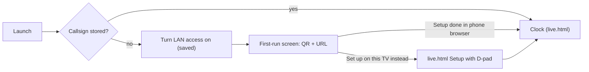

# Plan: Vega HamClock, after Phase 3

Phases 0–3 are done and committed on `vega-app` (engine in the app, WebView UI, LAN access, mDNS). This plan groups the open items, plus your two decisions, into four phases, in the suggested order of work.

**Update 2026-10-29:** Phase 4 is done (commit `a25cd9a`; see `vega/PHASE4_RESULTS.md`). Phase 4B (UA platform `HamClock-vega`, per-install S/N from a virtual MAC) is done (commit `cc20a93`; results in the same file). Phase 5 is done (see `vega/PHASE5_RESULTS.md`; overscan is fitted inside the page, not as RN padding; text fields open the keyboard only on OK). Phase 5 follow-ups (in the Phase 5 commit `8959054`): `-k` on every start, new HamClock `-u` (Setup at once). Next: Phase 6 (now includes items 6 and 7).

**Update 2026-10-29 (later):** Phase 6 is done (see `vega/PHASE6_RESULTS.md`): hold speed-up in the page, screensaver held off by an inaudible WebAudio tone (TimeoutManager doesn't help), engine log separated by linker wraps, no subprocesses in the sandbox (curl panes hidden on Vega), backend applied on leaving Settings, first-run presets (geoIP DE, NTP = Computer) written before Setup. Next: Phase 7.

**Update 2026-10-30:** Phase 7 is done (see `vega/PHASE7_RESULTS.md`). Release build, version from the tag with the commit count as the build number, armv7 and aarch64 packages, Jest and host C++ tests, `vega.yml` CI (verified on GitHub; PRs and manual runs only), README. The WebView is memoized. Merging `vega-app` waits for the user's review. Next: Phase 8, the Vega SDK 2.0 upgrade (plan below).

**Update 2026-10-30 (later):** Phase 8 (SDK 2.0.13986) is done on branch `vega-sdk2` (see `vega/PHASE8_RESULTS.md`). OS target 2.0, min 1.2; no app or engine code changes; FRESH Release on the TV passes every check. Pending: a GitHub run of `vega.yml` (user), then merging `vega-sdk2` into `vega-app`.

_This file is the maintained copy of the plan (moved into the repo after Phase 6; the original was a conversation artifact)._

**Your decisions (built in below):**
- **No callsign seeding.** The user always enters their own callsign. The Android app never seeds either; it only reads the stored callsign to detect first setup.
- **First run** turns LAN access on and opens the QR code screen.
- **After first run, LAN access stays on by default**; the user can turn it off in the settings panel.
- **Self-test seeding is test-only.**
- **Package ID is `org.openhamclock.hamclock`** (you own openhamclock.org). Done on 2026-10-28; see Phase 7.1.

---

## Phase 4: First-run setup

**Goal:** on a fresh install, the TV shows a setup screen with a QR code and URL. The user scans it with a phone, enters the callsign in HamClock's own Setup page, and the TV goes straight to the clock.

### 4.1 Remove seeding

- **App:** remove `seedCallsign`/`seedLat`/`seedLng` from all app paths.
- **Engine:** drop the options from the `EngineOptions` docs. `NvSeed.cpp` becomes a read-only check, `hasStoredCallsign(dataDir)`, using HamClock's NV API on the engine thread before `hamclock_main`, as now.
- **Self-test:** it needs a finished Setup to test REST, so keep seeding as a test-only option renamed `testSeedCallsign`, used only by `selfTest.ts` (decided).

### 4.2 Know when Setup is needed and when it's done

- `getStatus()` gains `setupComplete`:
  - false if no callsign was stored when the run started;
  - true once the REST port is listening, because HamClock starts REST only after Setup (Phase 1 finding 5).
- No file parsing and no NV reads while the engine runs, so no thread-safety risk. (Android parses the eeprom file instead.)

### 4.3 QR code without new dependencies

- The engine already contains `qrcodegen.cpp`. Add a native call, `qrMatrix(text)`, that returns the module grid.
- RN draws it as rows of `View`s: white quiet zone, black modules, sized for scanning across a room.

### 4.4 First-run screen (native RN, shown over the WebView)

- **When it appears:** whenever `setupComplete` is false and the user hasn't chosen "Set up on this TV".
- **LAN access:** turned on and saved automatically when the screen first appears, so the QR works immediately.
- **Content** (wording based on the Android app):
  - "Welcome to HamClock on TV";
  - three short steps;
  - the QR code for `http://<mdnsHost>:8081/live.html`. It shows the IP URL until mDNS has announced, then switches to the `.local` URL;
  - both URLs as text;
  - a live status line: "Waiting for setup…".
- **Buttons:**
  - "Set up on this TV instead": hides the screen; the user does Setup in live.html with the D-pad.
  - "Exit app".
- **Closes by itself** as soon as `setupComplete` turns true.
- **Back** on this screen opens the normal settings panel.

### 4.5 After first run

- LAN access stays on by default, as in the Android app, so the user can keep configuring from the laptop. The user can turn it off in the settings panel, and that choice is saved (decided).
- Quitting mid-setup shows the screen again at next launch.

**Verification:**
- Clear `/data/hamclock` (or reinstall), then launch: the screen appears and LAN is on.
- The phone scans the QR, finishes Setup, and the TV switches to the clock without a key press.
- Repeat using "Set up on this TV instead".
- Relaunch: no first-run screen.

---

## Phase 4B: Engine identity (User-Agent platform and serial number). Do this first; it's small and engine-only.

HamClock sends `User-Agent: <platform>/<version> (id <S/N> up <secs>) …` to the backend (`wifi.cpp` `sendUserAgent`, ~L1452 and ~L1482) and `-A "<platform>/<version>"` in its curl calls. The S/N is `ESP.getChipId()`.

**What the Vega engine sends today** (checked on the TV via `GET :8080/get_sys.txt`):
- `Platform HamClock-linux`: the SDK defines `__linux__` and not `__ANDROID__`, so `ArduinoLib.h` picks `_IS_LINUX`.
- `MACaddr FF:FF:FF:FF:FF:FF` and `S/N 4294967295` (0xFFFFFFFF, "unknown"). `WiFi::macAddress()` shells out to `/sbin/ip` / `/sbin/ifconfig`, which don't exist on the TV (and the app can't read the MAC anyway). `getChipId()` tries `/proc/cpuinfo` "Serial" first; the TV's shell user sees one, but the engine got nothing in the app sandbox.

### Where platform strings live

| Where | What |
|:--|:--|
| `ESPHamClock/webserver.cpp` L9–28 | The `#if` chain that defines `platform`: `ESPHamClock`, `HamClock-android` (as `char[32]`, so it can be overwritten), `-armbian`, `-rpi`, `-linux`, `-apple`, `-FreeBSD`, `-NetBSD`, `-UNIX` |
| `ESPHamClock/HamClock.h` ~L3803 | `extern` declaration: `char platform[32]` on Android, `const char platform[]` otherwise |
| `android/app/src/main/cpp/hamclock_jni.cpp` ~L290 | Android app overwrites it with `HamClock-amazon` on Amazon (Fire OS) devices |
| `android/.../AppUpdateHelper.kt` ~L231 | Android app's own update check UA: `HamClock-android/<version>` |
| Uses of `platform` | `wifi.cpp` (UA ~L1452/1482, curl ~L1529), `hamsat.cpp` ~L298/303, `meshtastic.cpp` ~L192, `cfg_info.cpp` ~L277 (`platform=` key; example in `cfg_info_format.h` L19), `webserver.cpp` ~L1822 (`get_sys.txt`), `ESPHamClock.cpp` ~L289 (startup log) |

No code in this repo parses the platform string on the backend side; check the backend (ohb) separately if it keeps a list of known platforms.

### 4B.1 Platform `HamClock-vega`

- Add `#elif defined(_IS_VEGA)` → `const char platform[] = "HamClock-vega";` to the chain in `webserver.cpp`, **before** the `_IS_LINUX*` branches (`_IS_LINUX` is also defined on Vega). The engine build already defines `_IS_VEGA` (`hcengine/CMakeLists.txt`).
- This is an upstream source change: keep it to that one `#elif`, like the Android branch.

### 4B.2 Stable serial number from a virtual MAC

- Same approach as the Android app (`hamclock_jni.cpp` L55–104): wrap `WiFi::macAddress()` with the linker (`--wrap=_ZN4WiFi10macAddressEv`, alongside the existing wraps in `SysWraps.cpp` / `CMakeLists.txt`).
  - Read `<dataDir>/.mac_address` (same file name as Android). If it's missing or invalid, generate a locally administered unicast MAC (`02:xx:xx:xx:xx:xx`, first byte `(b & 0xFE) | 0x02`) from `/dev/urandom`, write it atomically (tmp + rename), and return it.
  - Called on the engine thread; the data dir is known from `EngineOptions`/`our_dir`.
- Make `getChipId()` use the MAC on Vega: skip the `/proc/cpuinfo` branch when `_IS_VEGA` is defined (a small `#if !defined(_IS_VEGA)` in `ArduinoLib/ESP.cpp`), or also wrap `ESP::getChipId`. Otherwise a sandbox that one day exposes `Serial` would change the S/N mid-install.
  - S/N = last 4 MAC bytes (`(m3<<24)+(m4<<16)+(m5<<8)+m6`), so it's random per install.
- Lifetime: `/data` survives app updates and terminate (Phase 0) and is wiped on uninstall, so the S/N lasts for the install. Anything that clears app data later (e.g. a "clear cache" option, as Android has) must keep `.mac_address`, as Android does (`MainActivity.kt` ~L800).

**Verification:**
- `GET :8080/get_sys.txt` shows `Platform HamClock-vega`, a `02:…` MAC and a S/N other than 4294967295.
- The same MAC and S/N after terminate/relaunch and after an app update (reinstall without uninstall).
- A new MAC and S/N after uninstall + install.
- The backend sees `HamClock-vega/<version> (id <S/N> …)` (check a request with the UA, e.g. via the engine's `diagnostic-log.txt`, or ask the backend owner).

---

## Phase 5: Settings and TV polish

1. **One settings store.** Replace `vega-lan-access` with `<dataDir>/vega-settings.json`, read and written natively and loaded at engine start.
   - Fields: `lanAccess`, `mdnsName`, `backend`, `overscan`.
   - Migrate the existing file.
2. **Editable mDNS name** (your to-do).
   - A `TextInput` in the settings panel. Check that the TV on-screen keyboard works; it may need `com.amazon.inputmethod.service` in the manifest, which the earlier branch declared.
   - Validate as a DNS label. Changing it re-probes.
   - The responder takes `mdnsName` from options; the instance name follows it.
3. **Backend host setting** (Android has "Backend Host (host:port)"). Saved; restarts the engine.
4. **Screen safe margin (overscan):** None / 3% / 5%, as in Android. Applied as padding around the WebView.
5. **QR code in the settings panel** when LAN access is on, reusing 4.3 (Android shows it there too).
   - QR codes always encode the **IP URL** (decision 4). First switch the Phase 4 first-run QR, which currently prefers `.local`. The `.local` URL stays as text.
6. **Panel layout check** at 10 ft once all of the above is in; the panel will need sections or a second page.

**Verification:**
- Each setting survives a relaunch.
- A name change shows up in `avahi-browse`.
- A backend change appears in the `run` event args.
- Overscan is visible on the TV.

---

## Phase 6: Remote, screensaver, lifecycle

1. **D-pad speed-up on hold.**
   - First measure whether Vega repeats keys while a button is held, and at what rate (log `[HCWEB]` timestamps while holding).
   - If it repeats: map the repeat rate onto live.html's speed-up, which only triggers on presses under 200 ms apart.
   - If not: repeat in `KEY_ROUTER_JS` on key down/up, at roughly the Android app's feel.
2. **Screensaver.** The earlier branch used `TimeoutManager.setTimeout(id, 0)` / `setLifespan(PERMANENT)` plus `useSetTimeoutCallback` (commits `c0e1797`, `e4d54c1`, the latter adding `com.amazon.audio.control`).
   - Check that these APIs exist in the current SDK, apply them, and confirm the app isn't sent to the background after the idle timeout.
3. **Home and background.** The engine keeps serving best-effort (Phase 0).
   - On return to the foreground, reload the page if the WebView was paused long enough to go stale.
   - Make sure the status polling restarts.
4. **Diagnostics.** `makeDiagFile` redirects stdout/stderr (dup2) for the whole app process, so RN output lands in HamClock's log.
   - Redirect only when not embedded (an `ArduinoLib` embed hook), or send the engine's log to its own file.
   - Then clean up `getLogTail`.
5. **curl in the sandbox.** `hamsat.cpp` and `wifi.cpp` shell out to `curl`.
   - Test from the engine (popen) on the TV.
   - If it doesn't work, disable those features cleanly behind `_VEGA` and note it.

6. **Backend: no restart on Done** (noted after Phase 5). Done in the Backend field only saves; the user may have other changes. Restart once, when needed, on an explicit save (leaving the settings page, or a Save/Apply button).
7. **First-run presets** (noted after Phase 5), written before HamClock's first Setup:
   - DE location from geoIP (TVs have no GPS). `-k` turns off `-i` (`Arduino.cpp`: `if (init_iploc && !skip_skip)`), so preset the stored setting instead. _(Correction, Phase 6: that line is the usage check "-g requires -k"; the geoIP flag is `-g`. It was not used because it geolocates after Setup; see PHASE6_RESULTS.md 6.7.)_
   - NTP setting = "computer" (HamClock can't set the TV's clock).
   - Find the NV/prefs keys in `setup.cpp`; Setup must still open on first run for the callsign.

**Verification:**
- Holding an arrow speeds up the cursor smoothly.
- The app stays in the foreground past the screensaver timeout.
- Home → back resumes a live clock.
- `getLogTail` shows only engine output.
- Changing the backend and then other fields restarts the engine once, on save.
- FRESH install: Setup shows geoIP location and NTP = computer already selected.

---

## Phase 7: Release readiness

1. **Package ID: done.** Switched to `org.openhamclock.hamclock` (`manifest.toml`, `app.json`, runner scripts).
   - The old `com.openhamclock.hamclock` app was uninstalled from the TV.
   - The new install replaced an `org.openhamclock.hamclock` build left from the earlier `feat/vega-support` attempt.
2. **Icon, title, version.** Reuse the earlier branch's icon and `sync-version.js` idea: the version comes from the HamClock version, plus a build number.
3. **Architectures.** Build and test armv7 (this TV) and aarch64, if Vega Fire TVs with arm64 exist.
4. **Release build.**
   - Leave out the self-test.
   - Turn off `[HCWEB]` key logging (keys, keyups, visibility, audio), `[HCLAN]`, `[HCSET]`, `[HCFIELD]`, `[HCEV]`, `[HCAPP]` and the watchdog option (or put them behind a debug flag).
   - Check that the crash fixed with "Reload display" doesn't show up in Release (WebView remount path).
5. **Tests.**
   - Jest for the lifecycle reducer and first-run logic.
   - A small host-built C++ test for `peerAllowed` and mDNS packet parsing/building, which doesn't need the TV.
6. **CI.** A GitHub workflow that builds the `.vpkg`; the earlier branch had a `release.yml` job to borrow from.
7. **Docs.**
   - `vega/README.md` (build, install, runner scripts).
   - ARCHITECTURE.md marked as superseded where the PHASEn results differ.
   - Decide how `vega-app` gets merged.

**Verification:** a Release `.vpkg` installs cleanly on a TV that has never had the app, runs first-run setup end to end, and shows no debug log lines.

**Order of work (agreed 2026-10-29):** 7.2 → 7.4 → 7.3 → 7.5 → 7.6 → 7.7. The Phase 6 carry-over check (SATACT/Meshtastic missing from the pane menu) is folded into the first Release test, with Setup done as N0CALL.
- Debug logging: gated by the build type (`__DEV__`); no runtime toggle.
- Version: from the release tag (`v4.34b00.0` or `v4.34.0`), passed in at build time as for Android (`TAG` env, `release.yml`). Build number = git commit count, as Android's `versionCode`.
- aarch64: build only (no arm64 Vega device known).

**Progress (2026-10-29):**
- 7.2 done: icon `assets/image/icon.png` (from `feat/vega-support`) on the package and the component, title "HamClock". `scripts/version.js` gives `--build-version`/`--build-number` (tag without `v`, or `edge`; git commit count), used by `npm run build:*` and the runner `tmp/vega-spike/run-p7.sh` (`BTYPE=Release`). The CLI puts them in the package's `meta-info/build-info.json`; the TV reports exactly that (`vpm info`: `version 4.34b00.0`, no semver mapping needed). `manifest.toml`'s `version` is a placeholder.
  - The TV refuses a lower build number (`Package version decrease`): a build from an older commit needs an uninstall first. The runner now stops on a failed install.
- 7.3 done (build only): `vega build -t aarch64` (engine) + `build-vega --target aarch64` give `hamclock_aarch64.vpkg` with an aarch64 `libHcEngine.so`.
- 7.4 done: JS debug lines behind `__DEV__` (`debugLog`, page `dbg`); the self-test is `require`d only under `__DEV__` (absent from the Release bundle); the engine ignores `watchdogSec`/`testSeedCallsign` under `NDEBUG` (Release). FRESH Release install on the TV: first-run presets OK, Setup as N0CALL OK, no `[HC…]` lines, pane menus complete (user), LAN toggle (WebView remount) without a crash.
  - The log shows `useComponentInstance is deprecated` every 3 s from Amazon's `WebView.kepler.js` on each re-render (also in Phase 6 Debug); not ours.
- Sat_Alerts (hams.at) and Mesh_Mon are back in the pane menus (the Phase 6 `plotmgmnt.cpp` change is reverted, so that file is upstream again). On Vega they fail when fetching, because `connectCommand` (curl) returns false. **Needs work:** see "Needs work" below.
  - **Phase 6 bug fixed by this revert:** the `_IS_VEGA` `return (false)` sat in the middle of the fallthrough chain of "always available" choices, so every choice above it (Aurora, DRAP, Solar Wind, SSN, X-Ray, SDO, Moon, Contests, …) was unavailable on Vega: missing from the menus and refused by `set_pane`. After the revert, `set_pane` accepts Aurora, DRAP, Solar_Wind, Sat_Alerts and Mesh_Mon (Release, on the TV).
- LAN toggle in Release (user, plus log): the engine restarts and the WebView remounts (renderer stopped/started at each switch), same app process throughout. No crash. The panel stays open for a LAN change, so the "Restarting" card is hidden behind it.
- 7.5 done:
  - Jest (`npm test`): the lifecycle reducer, `firstRunVisible` and the LAN/QR URL helpers moved unchanged from `App.tsx` to `src/lifecycle.ts`; `test/lifecycle.test.ts` (19 tests: READY/RESTARTING transitions, page reload on READY and on a new run, panel kept for a LAN restart, first-run show/hide cases, QR = first IP URL).
  - Host C++ (`npm run test:engine`, i.e. `make -C hcengine/test/host`): `peerAllowed` (v4/v6 ranges, v4-mapped, edges of 172.16/12), mDNS name encode/decode (compression, pointer loops, truncation), records and TTL/flush rules, answers over a loopback UDP socket, conflict detection (other IP, probing, SRV port), and the mDNS name/backend validators. It compiles `LanFilter.cpp`/`Settings.cpp` and includes `MdnsResponder.cpp` with `EngineHost` stubbed; no engine source changes. 108 checks; a deliberately broken `LanFilter.cpp` makes it fail.
- 7.6 done:
  - `scripts/build.sh` (engine, then app, for each arch, with the version args).
  - `.github/workflows/vega.yml`: test job (`tsc`, lint, Jest, host C++), then a build job that installs the Vega SDK with `get_vvm.sh` non-interactively.
  - `release.yml`: `build_vega` input; attaches `org.openhamclock.hamclock-<TAG>-vega-<arch>.vpkg` to the release.
  - A clean-checkout run of the test job found a lint error: `@amazon-devices/webview` was `^4.0.2`, and system-distributed libraries must be pinned with `~`. Fixed in `dfd279c`.
  - First GitHub run passed (run 41074400476): the SDK installs non-interactively, and the artifact installs and runs on the TV. Afterwards: PR/manual triggers only, Node 24 actions (v6), telemetry opted out, the informational SDL import lint is off (`77aab80`).
- 7.7 done: `README.md` written (build, install, tests, versioning, Debug vs Release, CI, limitations, docs index). `ARCHITECTURE.md` now has a "superseded" banner. Merging `vega-app` waits for the user's review.
- Extra: the WebView element is memoized (`f592f99`), so the 3 s status polling no longer triggers Amazon's "useComponentInstance is deprecated" log.

---

## Phase 8: Vega SDK 2.0 upgrade (agreed 2026-10-30, before merging `vega-app`)

**Why:** SDK 2.0.13986 (2026-10-29) is the general release of Vega OS and SDK 2.0. We're on 0.24.12112. The TV already runs OS 2.0 (TV Ship/529). Amazon's 2.0 release-notes page returned 404 when checked; the steps below come from a web-search summary, so check each one against `vega ... --help` and the real output.

**Decision (2026-10-30):** `--os-min` stays **1.2**; the target is 2.0. The 2.0 tooling accepts it (`vega project doctor` passes).

**Steps:**
1. **Baseline.** Record the current state: `npm ci`, tsc, lint, Jest 19/19, `test:engine` 108/0, Release 1193 on the TV. Do the work on a branch off `vega-app` (e.g. `vega-sdk2`) so 0.24 stays a working fallback. Install 2.0 next to 0.24 (`vega sdk install 2.0.13986`); switch back with `vega sdk use 0.24.12112`.
2. **CLI and SDK.** Run `vega update` (CLI 1.4.7 now) and `vega sdk use 2.0.13986`. Check whether a project-level `vega-sdk-requirements.json` is expected.
3. **Project.** `vega project update-manifest --os-min 1.2 --os-version 2.0` (check the diff: `[os.version]`, the `IVega_1_2` needs entry, which may now be injected by `vega build`). Then `vega project install --fix`, `npm install` (new lockfile), and `vega project doctor`. Compare against a fresh 2.0 template app (`vega project` create) for package versions and config (`.eslintrc`, babel, metro, tsconfig).
4. **Packages.** React 19 / RN 0.83 / Hermes v1. Use 2.0 versions of `@amazon-devices/react-native-kepler`, `@amazon-devices/webview` (keep the `~` pins), the eslint plugin and typescript-eslint. Then re-check `npm audit` and the deprecation notices (PHASE7_RESULTS.md "Left as is"), and `hcengine/`'s package.json.
5. **Engine (C++).** Rebuild `libHcEngine.so` with the 2.0 toolchain for armv7 and aarch64. Watch for TurboModule/autolink API changes and new compiler warnings. Run `test:engine`.
6. **App code.** Fix tsc/lint/Jest. Watch for React 19 changes (`defaultProps`, refs, `useComponentInstance` and other WebView API changes), TV focus/key events (`useTVEventHandler`, `TVFocusGuideView`) and `BackHandler`.
7. **On the TV.** FRESH Release install (re-enter N0CALL): first-run presets, Setup, live clock, keys and hold speed-up, Back/Menu, settings panel, LAN toggle, QR, mDNS, screensaver tone, Home and return, no `[HC…]` lines. The build number must be higher than 1193.
8. **CI.** Set `VEGA_SDK_VERSION` to `2.0.13986` in `vega.yml` and `release.yml`. The user pushes and runs Vega by hand from the Actions tab.
9. **Docs.** Write `PHASE8_RESULTS.md`, update this file, and change the README prereqs ("Vega SDK 0.24.x").

**Environment:** TV `192.168.1.237:5555` (armv7), `source ~/vega/env`, system Node `/usr/bin/node`. Runner `tmp/vega-spike/run-p7.sh` (`BTYPE=Release`, `FRESH=1`, `NOBUILD=1`). The SDK manager is `vvman` (`vvman sdk list-remote|list-installed|install|use`). Never stage `docker/backend_host`. Don't run `screenshooter`.

**Progress (2026-10-30):**
- 1 done: baseline on 0.24 passed (tsc, lint, Jest 19/19, host C++ 108/0). Branch `vega-sdk2`. SDK 2.0.13986 installed next to 0.24 and active.
- 2 done: CLI 1.4.7 is already the latest. No `vega-sdk-requirements.json` is expected.
- 3 done: `vega project update --os-version 2.0 --os-min 1.2` (2.0 has this combined command). The `IVega_1_2` needs entry was removed from the source manifest; `vega build` now inserts `needs IVega_1_2` and `wants IVega_2_0`. Webview pin `~4.0.0` (SDK profile). `overrides` added as in the 2.0 templates. `doctor` clean.
- 4 done: no package changes needed beyond the above (the app was already on React 19.2 / RN 0.83). `npm audit` unchanged.
- 5 done: `hcengine/` matches the 2.0 turbo-module template; rebuilt for armv7 and aarch64 with no warnings.
- 6 done: no app code changes.
- 7 done: FRESH Release 1195 on the TV passes first run, Setup, keys, panel, QR, LAN toggle, screensaver, Home/return, identity and mDNS checks.
- 8 done locally: `VEGA_SDK_VERSION` 2.0.13986 in both workflows; GitHub run pending.
- 9 done: `PHASE8_RESULTS.md`, README prereqs.

---

## Needs work (after Phase 7)

- **Vega SDK 2.0 upgrade:** Phase 8 (above); done, GitHub CI run pending.
- **LAN toggle restart UX.** The settings panel stays open after a LAN change and hides the "Restarting" card.
- **hams.at (Sat_Alerts) and Mesh_Mon panes on Vega.** Both fetch with `curl` through `WiFiClient::connectCommand`, and Vega apps can't run subprocesses (PHASE6_RESULTS.md 6.5). They need an in-process HTTP(S) client in the engine (e.g. libcurl or a TLS library linked into `libHcEngine.so`, or a fetch through the app, like Android's JNI fetch pipe). The panes stay in the menus meanwhile.

---

## Other ideas (not scheduled; your call)

- **Antenna page in the QR screen.** Android offers a second QR for the REST server's antenna page on `:8080`. This could be a second tab in Phase 5.5.
- **Port conflicts.** If another app holds 8080/8081, binding gives up after 10 s retries. Show a clear error, or fall back to another port as Android does.
- **Update check.** Android tells the user when a new HamClock version exists. On Vega, the Appstore handles updates, so this is probably unnecessary.
- **Start on boot / keep running after close.** Android offers both. Phase 0 found no supported way on Vega, so leave them out rather than offer them half-working.

## Decisions log

1. After first-run setup, LAN access stays **on** by default; the user can turn it off. (Phase 4.5)
2. Self-test seeding stays as a **test-only** option; the app never seeds. (Phase 4.1)
3. Package ID: **`org.openhamclock.hamclock`**, done. (Phase 7.1)
4. QR codes always use the **IP address** URL. The mDNS name is for convenience when someone has to remember or type the address; a QR code can go straight to the IP. (Phase 5.5; first-run QR to be switched)
5. UA platform is **`HamClock-vega`**. (Phase 4B.1)
6. S/N comes from a **virtual MAC generated at first start and cached** in `<dataDir>/.mac_address`, so it stays the same for the life of the install. (Phase 4B.2)
7. SDK 2.0: OS **min 1.2**, target 2.0, so older Vega devices keep working. (Phase 8)
